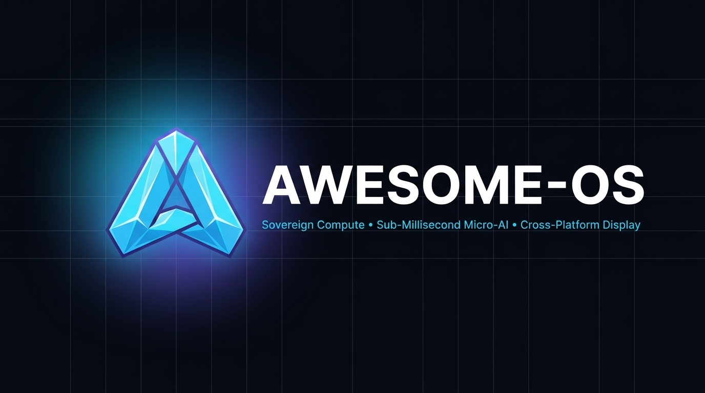

# Awesome-OS & Sectium

> **Sovereign BSD-3 Chromium-derived engine, `.b8p` content-addressed runtime, persistent multi-UI agent host, and local LLM/LoRA stack — engineered natively with zero closed vendor DLLs and zero WSL cross-compilation.**

---

## The 4-Stage Stack

1. **[Sectium](https://github.com/awesome-os/chromium.googlesource.com)** — Open-source BSD-3 Chromium-derived core engine (`0` closed Google/MS DLLs, `sectium-minimal-7` 7-subtree allowlist, unified `/shell` default interaction shell).
2. **B8G** — Zero-copy `SharedArrayBuffer` arenas (`B8G_ARENA_V1`), SHA-256 `.b8p` CAS packs with $O(1)$ CoW epoch-pointer rollbacks, persistent host daemons (`b8g-agent-host :7498`, `b8g-site-cms :7499`, `b8g-llm-studio :7497`), and Hyperscaler Desktop.
3. **StealifyLang & Holo** — Zero-AST TypeScript/WASI execution, 7-tuple execution context algebra, and `<b8g-*>` HTML5 `data-*` Streaming Web Components.
4. **Awesome-OS** — Bare-metal post-Chromium OS target (`KVM`/`VFIO`/`NTSYNC`, T2-SDE stripped to 31 core packages).

---

## Core Repositories & Live Sites

| Repository | Purpose |
| :--- | :--- |
| [**awesome-os/awesome-os**](https://github.com/awesome-os/awesome-os) | Main architecture blueprint, LLM & Persistent Host guides, and zero-LARP overview. |
| [**awesome-os/chromium.googlesource.com**](https://github.com/awesome-os/chromium.googlesource.com) | **Sectium** — Autarkic BSD-3 Chromium-derived core engine. |
| [**awesome-os/awesome-os.github.io**](https://github.com/awesome-os/awesome-os.github.io) | Official static site (`awesome-os.com`) built & deployed via `b8g-gh-pages`. |
| [**awesome-os/b8g.app**](https://github.com/awesome-os/b8g.app) | Official B8G App & Builder site (`b8g.app`). |

---

## Documentation
- [Master Architecture & Quick Start](https://github.com/awesome-os/awesome-os/blob/main/README.md)
- [Sovereign LLM, Embeddings, Unsloth LoRA & Colab Mesh Guide](https://github.com/awesome-os/awesome-os/blob/main/docs/SOVEREIGN-LLM-STACK-GUIDE.md)
- [Persistent Host Stack & Unified Sectium Shell Guide](https://github.com/awesome-os/awesome-os/blob/main/docs/PERSISTENT-HOST-AND-SECTIUM-SHELL-GUIDE.md)
- [Mental-Model & Tooling Cheatsheet](https://github.com/awesome-os/awesome-os/blob/main/docs/AWESOME-OS-CHEATSHEET.md)
